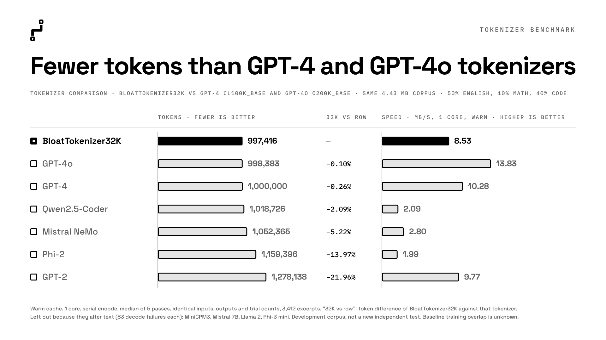
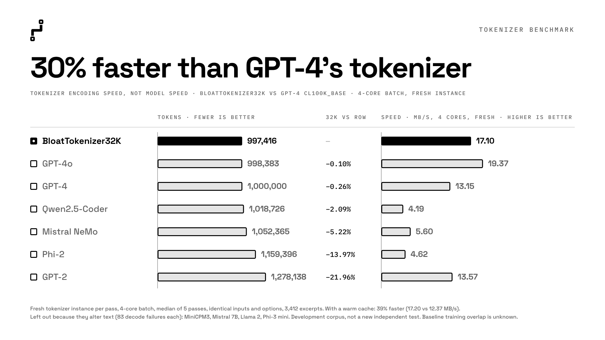

# BloatTokenizer32k

**Compact vocabulary. Efficient tokenization. Lossless decoding.**

BloatTokenizer32k is a text tokenizer with exactly **32,000 vocabulary entries**, a native C++ encoding engine, and Python bindings.

It supports language-model development, dataset preprocessing, and inference workflows involving English, programming languages, mathematics, and conversational text.

On the evaluated mixed-text corpus, BloatTokenizer32k produced token counts comparable to `cl100k_base` and `o200k_base` while using substantially fewer vocabulary entries.

## Highlights

- **32,000 vocabulary entries**, including 16 reserved control tokens.
- **21.96% fewer tokens than GPT-2** on the evaluated mixed corpus.
- **6.48% fewer tokens than `cl100k_base`** on the evaluated code subset.
- **17.20 MB/s** batch encoding after corpus warmup.
- **17.10 MB/s** batch encoding with fresh tokenizer instances.
- Exact decoding across all **3,412 evaluation excerpts**.
- Configurable parallel batch encoding with ordered results.
- Python interface, C++ engine source, and prebuilt Windows extensions.

The batch throughput figures were measured with four allowed logical CPUs. Results depend on hardware and workload.

## Quick start

The prebuilt extensions support **Windows x64 with CPython 3.12 or 3.14**.

Run this example from the release root—the directory containing `artifacts` and `engine`:

```python
import sys
from pathlib import Path

bundle = Path.cwd()
sys.path.insert(0, str(bundle / "engine" / "python"))

from curriculum_tokenizer import CurriculumTokenizer

tokenizer = CurriculumTokenizer.from_pretrained(
    str(bundle / "artifacts")
)

text = "Fast, lossless text encoding."

token_ids = tokenizer.encode(
    text,
    add_special_tokens=False,
)

decoded = tokenizer.decode(
    token_ids,
    skip_special_tokens=False,
)

assert decoded == text

print("Vocabulary size:", tokenizer.vocab_size)
print("Token IDs:", token_ids)
print("Decoded:", decoded)
```

By default, `encode()` and `encode_batch()` append `<|endoftext|>`. Passing `add_special_tokens=False` disables that automatic addition.

By default, `decode()` removes control tokens. Use `skip_special_tokens=False` to preserve them when reconstructing the original text.

Reserved marker strings already present in the input are still recognized when `add_special_tokens=False`.

## Batch encoding

`encode_batch()` returns a dictionary whose `input_ids` field contains one token-ID list per input text.

```python
texts = [
    "A short English example.",
    "x = 1 + 2",
    "The result is 3.",
]

batch = tokenizer.encode_batch(
    texts,
    add_special_tokens=False,
    num_threads=4,
)

for text, token_ids in zip(texts, batch["input_ids"]):
    decoded = tokenizer.decode(
        token_ids,
        skip_special_tokens=False,
    )

    assert decoded == text
    print(text, token_ids)
```

Batch encoding preserves input order. Set `num_threads` explicitly to control the worker count, or use `num_threads=0` for automatic selection.

## Special control tokens

The vocabulary includes 16 reserved control tokens with fixed IDs:

| Token | ID |
|---|---:|
| `<|endoftext|>` | 256 |
| `<|pad|>` | 257 |
| `<|system|>` | 258 |
| `<|user|>` | 259 |
| `<|assistant|>` | 260 |
| `<|end_turn|>` | 261 |
| `<|tool_call|>` | 262 |
| `<|end_tool_call|>` | 263 |
| `<|tool_result|>` | 264 |
| `<|end_tool_result|>` | 265 |
| `<|final|>` | 266 |
| `<|end_final|>` | 267 |
| `<|think|>` | 268 |
| `<|end_think|>` | 269 |
| `<|verify|>` | 270 |
| `<|end_verify|>` | 271 |

Applications determine how these markers are used for conversation formatting and structured inputs. Preserve their configured IDs when preparing model data or inference inputs.

## Benchmark results

The following results use identical input text and matched CPU budgets.

“Compression” here means fewer output tokens for the same text. It describes sequence length rather than compressed file size.

### Token counts





Lower counts indicate shorter token sequences.

| Tokenizer | Vocabulary entries | Output tokens |
|---|---:|---:|
| **BloatTokenizer32k** | **32,000** | **997,416** |
| `o200k_base` | 200,000 | 998,383 |
| `cl100k_base` | 100,261 | 1,000,000 |
| Qwen2.5-Coder | 151,665 | 1,018,726 |
| Mistral NeMo | 131,072 | 1,052,365 |
| Phi-2 | 50,295 | 1,159,396 |
| GPT-2 | 50,257 | 1,278,138 |

Vocabulary figures count defined entries, including special and added tokens; unused ID positions are not counted.

On this corpus, BloatTokenizer32k produced:

- **0.26% fewer tokens** than `cl100k_base`.
- **0.10% fewer tokens** than `o200k_base`.
- **21.96% fewer tokens** than GPT-2.

The result varies by domain:

| Domain | BloatTokenizer32k | `cl100k_base` |
|---|---:|---:|
| English | 522,543 | 500,000 |
| Mathematics | 100,805 | 100,000 |
| Code | 374,068 | 400,000 |
| **Total** | **997,416** | **1,000,000** |

The code subset used **6.48% fewer tokens** than `cl100k_base`. English and mathematics used more tokens on their respective subsets.

### Encoding throughput



Throughput is measured in **input MB/s**, where 1 MB is 1,000,000 bytes. Higher is faster.

Serial measurements allowed one logical CPU. Batch measurements allowed four logical CPUs.

| Tokenizer | Serial fresh | Serial warm | Batch fresh | Batch warm |
|---|---:|---:|---:|---:|
| **BloatTokenizer32k** | **7.58** | **8.53** | **17.10** | **17.20** |
| `cl100k_base` | 10.14 | 10.28 | 13.15 | 12.37 |
| `o200k_base` | 14.17 | 13.83 | 19.37 | 20.91 |
| Qwen2.5-Coder | 2.01 | 2.09 | 4.19 | 4.03 |
| Mistral NeMo | 2.40 | 2.80 | 5.60 | 5.40 |
| Phi-2 | 2.32 | 1.99 | 4.62 | 4.48 |
| GPT-2 | 10.67 | 9.77 | 13.57 | 8.00 |

In this configuration, BloatTokenizer32k achieved approximately **30% higher fresh-instance batch throughput** and **39% higher batch throughput after warmup** than `cl100k_base`.

Its serial throughput was lower than both `cl100k_base` and `o200k_base`.

### Evaluation configuration

| Property | Configuration |
|---|---|
| Excerpts | 3,412 |
| Input size | 4,427,375 UTF-8 bytes |
| Reference tokens | 1,000,000 using `cl100k_base` |
| Domain mixture | 50% English, 10% mathematics, 40% code, measured in reference tokens |
| Trials | Five per tokenizer and condition |
| Reported statistic | Median throughput |
| Scheduling seed | 20261021 |
| Requested output | Token IDs only |
| BloatTokenizer32k decode failures | 0 of 3,412 excerpts |

Every tokenizer received the same excerpts in the same order, without concatenation or re-chunking. Automatic BOS/EOS insertion, padding, truncation, attention masks, and chat templates were disabled.

Fresh measurements started with a newly constructed tokenizer; construction time was excluded. Warm measurements followed a complete untimed pass through the corpus. Hardware and operating-system caches were not flushed.

The recorded software environment was Windows 11, CPython 3.14.6, `tiktoken` 0.13.0, `tokenizers` 0.23.2, and `transformers` 5.16.1.

The evaluation corpus was held out from tokenizer training and had been inspected during development. These results describe that fixed development evaluation; performance on other datasets and hardware may differ. Public baseline training-data overlap is unknown.

The benchmark harness, baseline configurations, and evaluation corpus are additional reproduction requirements and are not included in the standalone inference bundle.

## Package contents

```text
BloatTokenizer32k/
├── artifacts/
│   ├── vocab.json
│   ├── merges.txt
│   ├── tokenizer_config.json
│   └── release_manifest.json
│
└── engine/
    ├── python/
    │   └── curriculum_tokenizer/
    ├── include/
    ├── src/
    ├── setup.py
    ├── pyproject.toml
    ├── CMakeLists.txt
    └── README.md
```

Load the complete `artifacts` directory with the supplied Python package.

## Building the engine

Prebuilt binaries are included for Windows x64 with CPython 3.12 and 3.14. Other environments require a compatible native build.

To build from source, install a C++17 compiler and the Python build dependencies, then run from the `engine` directory:

```bash
python -m pip install setuptools wheel "pybind11>=2.10"
python setup.py build_ext --inplace
```

On Windows, a compatible Microsoft C++ build toolchain is required.

## Model compatibility

Use BloatTokenizer32k with models whose vocabulary and token-ID assignments match these artifacts.

An existing model’s input embeddings and output vocabulary must correspond to its tokenizer. Adopting this vocabulary for an unrelated pretrained model requires corresponding model adaptation.

The documented loading interface is:

```python
CurriculumTokenizer.from_pretrained("path/to/artifacts")
```

## Download

Download BloatTokenizer32k using either method:

**Option 1 — Download ZIP**

Click **Code → Download ZIP** on this GitHub repository, then extract the archive.

**Option 2 — Git**

```bash
git clone https://github.com/Dev-qvinfor/BloatTokenizer32k.git
cd BloatTokenizer32k
```

Run the Quick Start example from the extracted repository root.

Prebuilt extensions are provided for Windows x64 with CPython 3.12 and 3.14. Other environments may require building the C++ extension from source.

## Feedback

Bug reports, compatibility findings, and independent evaluations are welcome.

For reproducible reports, include the Python version, operating system, processor, tokenizer configuration, input characteristics, worker count, and whether measurements used fresh instances or corpus warmup.

## License

BloatTokenizer32k is released under the Apache License 2.0 license.

The license covers the publicly distributed C++ engine, Python interface, tokenizer vocabulary, merge rules, and configuration artifacts.

The proprietary tokenizer-training algorithm and training implementation are not included in this release.

See [LICENSE](LICENSE) for the complete terms.

